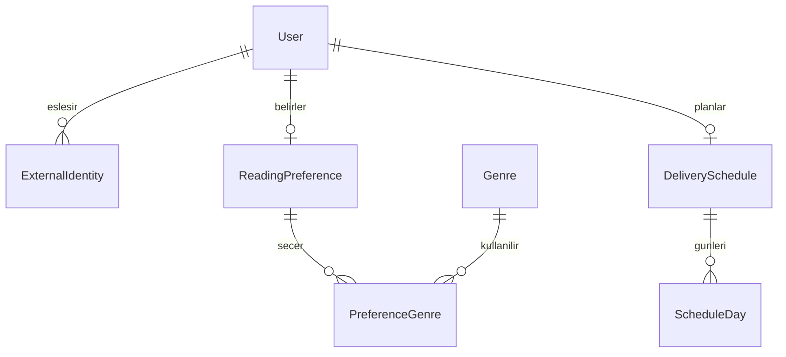
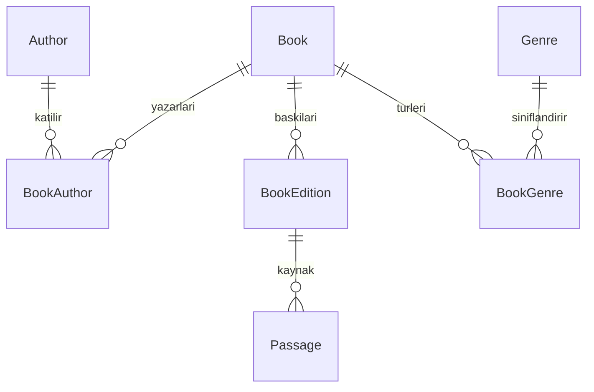
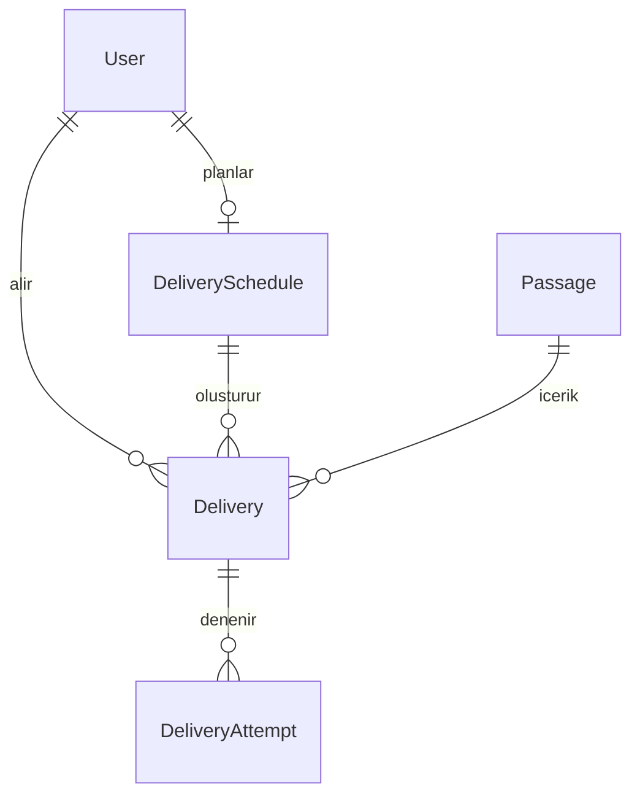

# PassagePort — Kullanıcı akışı ve veritabanı taslağı

Tarih: 4 Kasım 2026 · Sürüm: 0.2 · Durum: Uygulanan modeller ve sonraki adımların taslağı

Bu belge kullanıcı akışını, ilk veri modelini ve temel iş kurallarını tanımlar. İlk tercih akışının sekiz modeli ve kitap/yazar kataloğu `backend/` içinde oluşturuldu. Wix kimlik köprüsü, okuyucu ekranları ve gerçek gönderim sonraki geliştirme adımlarıdır. İlk API okuma süresini 1–60 dakika ile sınırlar.

## 1. Ürünün ilk çalışan hedefi

Okuyucu Wix üzerinden giriş yapar; bir veya birden fazla tür, okuma süresi, gönderim günleri ve saatini belirler. Tercihlerini kendi panelinde görür ve değiştirebilir. Sonraki geliştirmede sistem bu tercihlere uygun, kullanım hakkı kontrol edilmiş gerçek bir kitap pasajını e-postayla gönderir.

Kullanıcıya ücretli abonelik sunulmuyor. Bu belgede “gönderim planı”, e-posta gün ve saat ayarlarını ifade eder.

Başlangıç için önerilen sınırlar:

- Her okuyucunun tek tercih profili ve tek gönderim planı olur.
- Birden fazla tür ve haftanın birden fazla günü seçilebilir; seçilen günlerde aynı saat kullanılır. Her güne farklı saat sonraki bir genişletmedir.
- “Benim için seç”, tür seçiminin alternatifidir; ayrı bir kitap türü değildir.
- İlk içerikler Türkçedir. Yapay zekâ kitap pasajı üretmez veya pasajın metnini yeniden yazmaz.
- Chatbot ve form aynı tercih alanlarına yazar; kaydetmeden önce okuyucu bir tercih özeti görür.
- İlk çalışan kayıt/tercih akışında gerçek e-posta gönderimi açılmaz. Gönderim, içerik ve izin kontrolleriyle ayrı bir geliştirme adımıdır.

## 2. Ekranlar ve sorumluluklar

| Ekran | Kim erişir? | Temel işlemler |
| --- | --- | --- |
| Tanıtım ve okuma rehberi | Ziyaretçi ve okuyucu | PassagePort'u tanıma, tür önerisi alma, üyelik sayfasına geçme |
| Kayıt / giriş / şifre işlemleri | Wix Members | Wix kimlik doğrulama akışları |
| Okuyucu paneli | Giriş yapmış okuyucu | Kendi tercihlerini, gönderim planını ve ileride gönderim geçmişini görme |
| Okuma tercihlerim | Giriş yapmış okuyucu | Tür, süre, gün, saat ve saat dilimi ayarları; kaydetmeden önce özet |
| Gönderim ayarları | Giriş yapmış okuyucu | Gönderimi açma, duraklatma, yeniden başlatma ve izni geri çekme |
| Django yönetim paneli | Yetkili personel | Kitap/baskı/pasaj yönetimi, kaynak ve hak kontrolü, gönderim hatalarını inceleme |

Başlangıçta okuyucu ve yönetim ekranları farklı arayüzlerde bulunur: okuyucu Wix'te, içerik yönetimi Django Admin'dedir. Yetkiler ayrıca backend'de uygulanır.

## 3. Okuyucu akışları

### 3.1 İlk ziyaret ve tercih kaydı

1. Ziyaretçi siteyi inceler; isterse giriş yapmadan chatbot'tan tür önerisi alır.
2. Tercihlerini kaydetmek istediğinde Wix Members üzerinden kayıt olur veya giriş yapar.
3. Velo backend, oturum açan üyeyi kendi tarafında belirler. Django, doğrulanmış sunucular arası istek üzerinden üyeyi eşleştirir veya yeni okuyucu kaydı oluşturur.
4. Okuyucu türlerini veya “Benim için seç” seçeneğini belirler; okuma süresini seçer.
5. Gönderim günlerini, yerel saati ve saat dilimini belirler. İlk varsayılan saat dilimi `Europe/Istanbul` olur.
6. Ekran tercih özetini gösterir. Chatbot'un önerdiği ayarlar da burada okuyucu tarafından onaylanır.
7. Backend verileri doğrular ve tercih profilini/planı kaydeder.
8. E-posta doğrulaması ve gerekli gönderim izni tamamlanmamışsa plan `DRAFT` kalır; kullanıcı panelini kullanabilir.
9. Gönderim özelliği kullanıma açıldığında, tüm koşullar sağlanır ve okuyucu gönderimi açarsa plan `ACTIVE` olur.

Hesap oluşturmak tek başına e-posta gönderimini başlatmaz. Kullanıcı yalnızca tercih kaydetmeyi de seçebilir.

### 3.2 Geri dönen okuyucu

- Giriş yaptıktan sonra kendi kayıtlı ayarlarını görür.
- Tercih değişikliğini onaylayınca yeni ayarlar sonraki gönderimlere uygulanır.
- Plan veya tercih değiştiğinde plan sürümü artırılır; henüz gönderilmemiş eski işlerin güncelliği tekrar kontrol edilir.
- Duraklatma yalnızca gönderim planını etkiler. Hesap açık, tercihler saklı kalır.
- İzni geri çekme ayrı bir işlemdir; yeni gönderimler engellenir ve henüz sağlayıcıya verilmemiş işler iptal edilir.
- Yeniden başlatma, o anki hesap/izin/doğrulama koşullarına göre değerlendirilir. Kaçırılan e-postalar topluca gönderilmez.

### 3.3 Pasajın seçilmesi ve gönderilmesi

1. Zamanlayıcı, gönderim zamanı gelen aktif plan için tek bir gönderim kaydı oluşturur.
2. Sistem hesap durumunu, doğrulanmış adresi, güncel izni ve plan sürümünü kontrol eder.
3. Yayımlanmış, kullanım hakkı onaylı, dil/tür/süre tercihlerine uygun pasajlar arasından seçim yapar. Önceden gönderilmiş pasajlar tekrar seçilmez.
4. Uygun yeni pasaj yoksa gönderim `SKIPPED` olarak kaydedilir; metin uydurulmaz veya farklı türe sessizce geçilmez.
5. E-posta; pasajı, kitap/yazar ve kaynak bilgisini, tercih yönetimi ve gönderimi durdurma bağlantılarını içerir.
6. Sağlayıcı kabulü ve her gönderim denemesi kaydedilir. Geçici hata için aynı gönderim kaydı üzerinden kontrollü yeniden deneme yapılır.

Sağlayıcının e-postayı kabul etmesi, gelen kutusuna ulaştığı veya okunduğu anlamına gelmez. Teslim/bounce bilgisi ileride sağlayıcının doğrulanmış geri bildirimleriyle işlenir. Dış e-posta sisteminde mutlak “tam bir kez teslim” garantisi varsayılmaz.

## 4. Yönetici akışı

1. Yetkili personel Django yönetim paneline kendi personel hesabıyla giriş yapar.
2. Kitabı, yazarını ve pasajın alındığı baskı/çeviriyi kaydeder.
3. Pasaj metnini, kaynak konumunu, türlerini ve tahmini okuma süresini hazırlar.
4. Kullanım hakkının dayanağını ve varsa izin belgesini/kapsamını kaydeder.
5. Kontrol edilen pasaj yayımlanır. Yayımlama ve hak onayı ayrı koşullardır.
6. Gönderim kayıtlarını/hataları takip eder; gerekirse pasajı yayından kaldırır veya hak durumunu bloke eder.

Yetki önerisi:

| Rol | Yetki |
| --- | --- |
| Okuyucu | Kendi profili, tercihleri, planı ve geçmişi |
| İçerik editörü — ileride | Kendisine verilen içerik işlemleri; kullanıcı yönetimi yetkisi otomatik verilmez |
| Yönetici | Kendisine tanımlanmış içerik, kullanıcı ve operasyon yetkileri |

Roller Django grup/izinleriyle yönetilir. `is_staff` yönetim arayüzüne erişim içindir; her personeli `superuser` yapmak gerekmez. Wix'ten veya tarayıcıdan gelen rol adı doğrudan yönetici yetkisi vermez.

## 5. Kimlik doğrulama ve kullanıcı eşleştirmesi

- Okuyucunun giriş sağlayıcısı Wix Members olur. Okuyucunun parolası PostgreSQL'e kopyalanmaz.
- Django'da tek bir özel `User` modeli kullanılır. Wix okuyucusuna yerel parola atanmaz; Django'nun kullanılamayan parola mekanizması kullanılır.
- Yönetim personeli Django'nun parola/oturum altyapısıyla giriş yapar. Bu, okuyucuya ikinci bir giriş yaptırmak anlamına gelmez.
- `ExternalIdentity`, Wix üyesini yerel kullanıcıya bağlar. Eşleşme anahtarı e-posta değil, sağlayıcı + site kimliği + üye kimliğidir.
- E-posta çakışmasında hesaplar otomatik birleştirilmez; doğrulanmış hesap bağlama süreci gerekir. Böylece aynı e-postanın bildirilmesi yönetici hesabına erişim sağlamaz.
- Kimlik ve site bilgileri Velo backend'den alınır. Tarayıcının gönderdiği `user_id`, `member_id` veya `role` alanları yetki kaynağı değildir.
- Velo–Django bağlantısında HTTPS ve doğrulanan, süreli/imzalı sunucular arası kimlik aktarımı tasarlanır. İmza, geçerlilik süresi ve hedef site kontrolü yapılır; ortak gizli değerler tarayıcıya gönderilmez.
- Wix üyelik kabul durumu, e-posta doğrulamasının kanıtı olarak varsayılmaz. Güvenilir doğrulama bilgisi entegrasyonda teyit edilir; sağlanamıyorsa gönderim adresi uygulamanın doğrulama akışıyla doğrulanır.
- Her okuyucu API'si yalnızca kimliği doğrulanmış kullanıcının kayıtlarına erişir; listeleme ve tek kayıt erişimi birlikte sınırlandırılır.

Özel `User` modeli ilk Django migration'ından önce tanımlanmalıdır.

## 6. Veritabanı — ilk tercih akışının tabloları

Kodda İngilizce model adları, ekranlarda Türkçe adlar kullanılabilir. `id`, `created_at` ve gerekli yerlerde `updated_at` ortak alanlardır. Aşağıdaki alanlar taslak niteliğindedir.

| Tablo / model | Önemli alanlar | İlişki ve kural |
| --- | --- | --- |
| Kullanıcılar — `User` | `id`, `email`, `display_name`, `email_verified_at`, `is_active`, `is_staff` | Normalize e-posta benzersizliği; hesap durumu yalnızca hesap erişimini ifade eder. Parola yönetimi Django mekanizmasına bırakılır. |
| Dış kimlikler — `ExternalIdentity` | `user_id`, `provider`, `site_id`, `subject` | `(provider, site_id, subject)` benzersiz. İlk sağlayıcı `wix`; `subject` Wix üye kimliğidir. |
| Okuma tercihleri — `ReadingPreference` | `user_id`, `selection_mode`, `target_minutes`, `language` | Kullanıcı başına en fazla bir profil. `selection_mode`: `SELECTED` / `RANDOM`. Süre pozitif; ilk dil `tr`. |
| Türler — `Genre` | `id`, `code`, `name`, `description`, `is_active` | `code` benzersiz; açıklama isteğe bağlıdır. Bilim kurgu, felsefe, fantastik, mizah ve polisiye ilk kategori önerileridir. |
| Tercih–tür bağlantıları — `PreferenceGenre` | `preference_id`, `genre_id` | İkili benzersiz. Çoklu tür seçimini sağlar. |
| Gönderim planları — `DeliverySchedule` | `user_id`, `local_time`, `timezone`, `status`, `next_run_at`, `version` | Kullanıcı başına en fazla bir plan. `DRAFT` / `ACTIVE` / `PAUSED` / `STOPPED`. |
| Plan günleri — `ScheduleDay` | `schedule_id`, `weekday` | `(schedule_id, weekday)` benzersiz; 0=Pazartesi … 6=Pazar. Her gün seçimi yedi satırla temsil edilir. |
| İzin olayları — `ConsentEvent` | `user_id`, `purpose`, `channel`, `action`, `text_version`, `recorded_at`, `source`, `email_at_event` | Verme/geri çekme olayları geçmişiyle saklanır. Aynı amaç/kanal için son geçerli olay esas alınır. |

Günlük/haftalık sıklık ayrıca çelişebilen bir alan olarak saklanmaz; seçilen günlerden türetilir. “Her gün” seçimi yedi günün tamamıdır.

Seçilen türlerden en az biri bulunması, aktif planın en az bir günü olması ve güncel iznin bulunması gibi tablolar arası kurallar servis katmanında transaction içinde doğrulanır. Alan sınırları, yabancı anahtarlar ve benzersizlikler ayrıca veritabanında uygulanır.

## 7. Kitap kataloğu ve sıradaki içerik/e-posta tabloları

4 Kasım 2026 güncellemesi: `Author`, `Book`, `BookAuthor` ve `BookGenre` modelleri ile yönetim paneli hazırlandı.
Kitap/yazar adları tek başına benzersiz değildir. Özgün dil bilinmiyorsa boş bırakılabilir; çeviri dili baskı kaydında tutulacaktır.
Katalog kaydı, yazar ve tür bağlantıları daha sonra tamamlanmak üzere saklanabilir; kaydetmek yayımlama veya gönderim onayı değildir.
`BookEdition`, `Passage`, `Delivery` ve `DeliveryAttempt` aşağıda sonraki adımlar olarak tasarlanmıştır.

| Tablo / model | Önemli alanlar | İlişki ve kural |
| --- | --- | --- |
| Yazarlar — `Author` | `id`, `name` | Aynı isimli farklı kişiler olabilir; ad tek başına benzersiz kimlik değildir. |
| Kitaplar — `Book` | `id`, `title`, `original_language`, `description`, `created_at`, `updated_at` | Eser bilgisi. Yazarlarla ve türlerle çoktan çoğa ilişki. |
| Kitap–yazar — `BookAuthor` | `book_id`, `author_id`, `position` | İkili benzersiz; çok yazarlı kitapları destekler. Pozitif sıra bilgisi bağlantıda tutulur; sıralı erişim `book.author_links` üzerinden yapılır. |
| Kitap–tür — `BookGenre` | `book_id`, `genre_id` | İkili benzersiz; bir kitap birden fazla türe ait olabilir. |
| Baskı/çeviriler — `BookEdition` | `book_id`, `publisher_name`, `translator_name`, `publication_year`, `language`, `isbn`, `source_url`, `purchase_url` | Pasajın hangi metin/baskıdan alındığını belirler. Satın alma bağlantısı isteğe bağlıdır. |
| Pasajlar — `Passage` | `edition_id`, `text`, `source_locator`, `word_count`, `estimated_reading_seconds`, `publication_status`, `rights_status`, `rights_basis`, `rights_evidence`, `rights_expires_at`, `approved_by`, `approved_at`, `revision` | Yayımlama ve hak onayı ayrıdır. `publication_status`: `DRAFT` / `PUBLISHED` / `ARCHIVED`; `rights_status`: `UNREVIEWED` / `APPROVED` / `BLOCKED`. |
| Gönderimler — `Delivery` | `user_id`, `schedule_id`, `schedule_version`, `scheduled_for`, `passage_id`, `passage_revision`, `recipient_email`, `content_snapshot`, `status`, `accepted_at` | `(user_id, scheduled_for)` benzersiz. Planlanan zamanın ve gönderilen içeriğin kaydı tutulur. |
| Gönderim denemeleri — `DeliveryAttempt` | `delivery_id`, `attempt_number`, `started_at`, `finished_at`, `result`, `provider_message_id`, `error_code` | `(delivery_id, attempt_number)` benzersiz. Geçici hata, kalıcı hata ve sonucu belirsiz deneme ayrılır. |

Bir baskının veya çevirinin hakkı, başka baskı/çeviri için otomatik kabul edilmez. Hak değerlendirmesinin kanıtı kaydedilir; yalnızca bir kaynak bağlantısının bulunması dağıtım onayı sayılmaz.

İlk sürümde pasaj, bağlı kitabın türleriyle eşleştirilir. Pasaj düzeyinde ayrıca tür etiketleme ihtiyacı doğarsa `PassageGenre` ilişkisi eklenebilir.

## 8. İlk aşamanın kritik kuralları

| Konu | Kural |
| --- | --- |
| Hesap, plan ve izin | Hesap aktifliği, gönderim planının durumu, adres doğrulaması ve gönderim izni birbirinin yerine kullanılmaz. |
| Tercih modu | `SELECTED` en az bir tür gerektirir. `RANDOM` onaylanmış mevcut havuzdan seçer; bu modda seçili tür bağlantısı tutulmaz. |
| Gün ve saat | En az bir gün ve geçerli bir IANA saat dilimi gerekir. Yerel saat ve saat dilimi ayrı tutulur; gerçekleşecek gönderim zamanı UTC anı olarak hesaplanır. |
| Tarih alanları | Olay ve gönderim anları PostgreSQL `timestamptz` alanlarında tutulur. Saat diliminin adı ayrıca plan üzerinde saklanır. |
| İçerik uygunluğu | Yayımlanmış, hak onayı geçerli ve tercihlere uygun pasaj gerekir. Tahmini okuma süresi kesin okuma süresi olarak sunulmaz. |
| Gönderim tekrarı | Aynı kullanıcı ve planlanan an için ikinci gönderim kaydı oluşturulmaz. Aynı pasajın daha önce seçilmiş/gönderilmiş olup olmadığı da kontrol edilir. |
| Yeniden deneme | Yeni bir `Delivery` oluşturmak yerine mevcut kayda `DeliveryAttempt` eklenir. Geçerliliğini yitiren eski işler gönderilmez. |
| İzin geri çekme | İzin olayı kaydedilir, plan durdurulur ve bekleyen işler iptal edilir. Worker, sağlayıcıya vermeden hemen önce durumu tekrar kontrol eder. |
| Adres değişikliği | Doğrulanmış adres otomatik olarak yeni adrese taşınmış sayılmaz; yeni adres doğrulanmadan gönderim yapılmaz. İzin durumu yeni adres bağlamında değerlendirilir. |
| Kaynak ve hak değişikliği | Pasaj bloke edilir veya izni sona ererse henüz gönderilmemiş işler yeniden değerlendirilir. |
| Kişisel erişim | Okuyucu yalnızca kendi kaydını görebilir/değiştirebilir; başkasının kimliğini istekte göndermesi erişim sağlamaz. |

`Delivery.status` ilk önerisi: `QUEUED`, `PROCESSING`, `ACCEPTED`, `FAILED`, `SKIPPED`, `CANCELLED`. Sağlayıcıdan doğrulanmış teslim geri bildirimi eklendiğinde `DELIVERED` ve `BOUNCED` durumları ayrıca ele alınır.

İndeks önerileri: aktif planlarda `next_run_at`; kullanıcı ve planlanan zamana göre gönderim geçmişi; pasaj yayım/hak durumu; kullanıcı/amaç/kanal ve olay sırasına göre izin geçmişi. Alan tipleri ve migration ayrıntıları modeller yazılırken kesinleşir.

## 9. Sonraki özellikler için genişleme noktaları

| Özellik | İleride eklenecek kayıtlar |
| --- | --- |
| Beğen / beğenme | `PassageFeedback`: kullanıcı + pasaj benzersiz; mevcut tercih güncellenebilir. |
| Okuma bildirimi | `ReadingConfirmation`: ilgili gönderim için okuyucunun açık onayı. E-posta açılması veya bağlantıya gidilmesi gerçek okumanın kanıtı sayılmaz. |
| Kitap takibi | `UserBookProgress`: kullanıcı + kitap benzersiz; seçildi / okunuyor / tamamlandı bildirimi. |
| Kitap testleri | `QuizQuestion`, `QuestionOption`, `QuizAttempt`, `QuizAnswer`; onaylı sorular ve deneme geçmişi. |
| Kullanıcı soru önerisi | `QuestionSubmission`: bekliyor / onaylandı / reddedildi; onaylayan personel ve tarih. |
| Puan ve rozet | `PointTransaction`, `Badge`, `UserBadge`; aynı kaynak olay için tekrar puan yazılmasını engelleyen benzersizlik. |

Puan miktarları, test geçme eşiği ve rozet koşulları bu belgede kesinleştirilmez. Yeni iş kurallarıyla birlikte tasarlanır.

## 10. Somut örnek ve ilk kabul ölçütleri

Örnek okuyucu: Bilim kurgu + mizah; hedef 5 dakika; pazartesi/çarşamba/cuma saat 20.30; `Europe/Istanbul`. Bu değerler örnek senaryodur, sistemin zorunlu seçenekleri değildir.

Bu örnekte bir kullanıcı, bir dış kimlik, bir tercih profili, iki tercih–tür bağlantısı, bir gönderim planı ve üç plan günü kaydı oluşur. E-posta izni ayrı bir olayla kaydedilir. Kitap/pasaj verisi henüz bulunmasa da tercih kaydı tamamlanabilir.

İlk kayıt/tercih geliştirmesinin kabul ölçütleri:

1. Yeni Wix üyesi güvenilir kimlikle eşleşir; tekrar girişte ikinci yerel kullanıcı oluşturulmaz.
2. Örnek tercihler kaydedilir ve sonraki girişte aynı değerler gösterilir.
3. Farklı okuyucu bu tercihleri listeleyemez, okuyamaz veya değiştiremez.
4. Geçersiz gün/saat/süre ve seçili türü olmayan `SELECTED` tercihi reddedilir.
5. Eksik gönderim koşulları hesabın kullanımını engellemez; planın etkinleşmesini engeller.
6. Okuyucu planını duraklatabilir; yönetici hesabı gerekli yetkilerle yönetim paneline giriş yapabilir.

## 11. Geliştirme sırası ve mevcut demo

1. Özel kullanıcı modeli, dış kimlik eşleştirmesi ve PostgreSQL bağlantısı.
2. Türler, tercih profili, gönderim planı/günleri ve izin geçmişi.
3. Yalnızca mevcut kullanıcıyı hedefleyen API'ler ve Wix “Okuma Tercihlerim” ekranı.
4. Kitap, yazar, baskı ve pasaj yönetimi; kaynak/hak kontrolü.
5. Tek bir test e-postası; ardından zamanlama, gönderim kayıtları ve yeniden deneme.
6. Geri bildirim, puan/rozet, kitap takibi ve testler.

Mevcut SQLite `leads` kayıtları ilgi talebidir. Otomatik olarak doğrulanmış üye, onaylanmış gönderim planı veya güncel e-posta izni kabul edilmez. Taşıma sırasında kaynak kayıt kimliği ve mevcut izin kanıtları korunarak ayrıca değerlendirilir. Eski demo seri isimleri, yeni türlerle kontrolsüzce eşleştirilmez.

## 12. Teknik dayanaklar

- [Django — Authentication özelleştirme ve özel kullanıcı modeli](https://docs.djangoproject.com/en/5.2/topics/auth/customizing/)
- [Django REST Framework — Erişim ve nesne izinleri](https://www.django-rest-framework.org/api-guide/permissions/)
- [PostgreSQL — Check, unique ve foreign key kısıtları](https://www.postgresql.org/docs/current/ddl-constraints.html)
- [PostgreSQL — Tarih, saat ve saat dilimleri](https://www.postgresql.org/docs/current/datatype-datetime.html)
- [Wix Studio — Members Area](https://support.wix.com/en/article/studio-editor-using-the-members-area)

Bu belgedeki tablo adları, ilk sürüm sınırları ve akışlar PassagePort için tasarım önerisidir; kaynaklar teknik olanakları açıklar. Şirket kuruluşu, başvurular ve 42 İstanbul bu taslağın kapsamı dışındadır.
